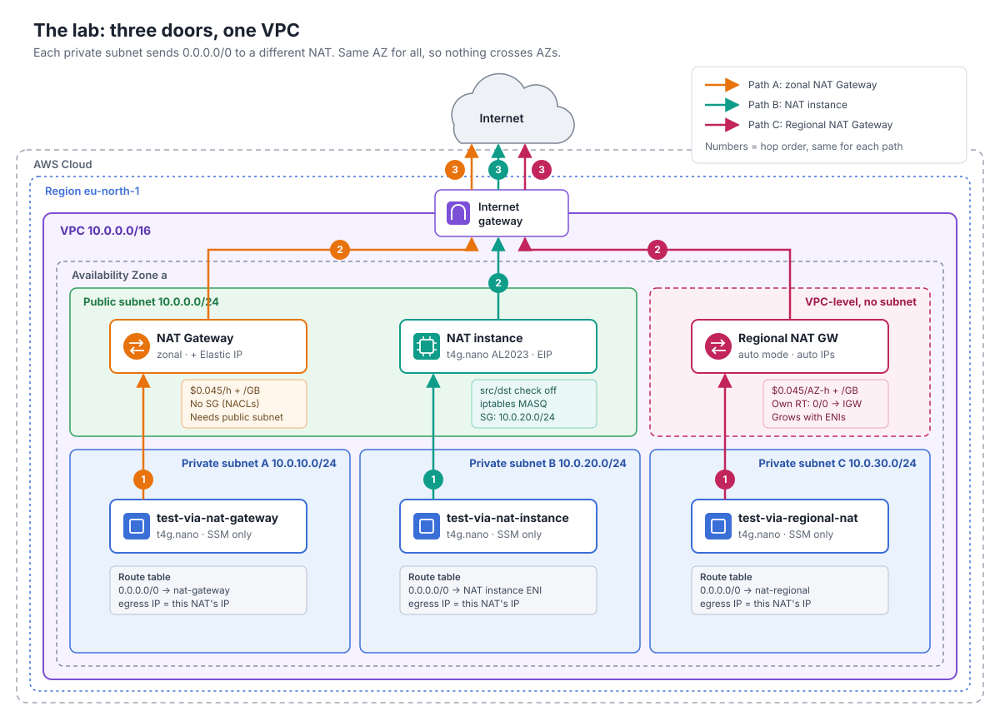

# aws_nat-gateway-vs-nat-instance

Three ways out of a private subnet, side by side in one VPC: a **zonal NAT Gateway**, a **Regional NAT Gateway** and a hand-built **NAT instance** on a `t4g.nano`. Deploy it, see which door each subnet uses, compare the bills, destroy it.

Companion lab for the article *NAT Gateway vs NAT Instance: Paying for the Exit*.

> **TL;DR:** NAT Gateway (Regional by default) for production. NAT instance for labs, sandboxes and short-lived non-production. This repo is the short-lived lab.

## Architecture



| Private subnet | CIDR | Default route | Expected egress IP |
| --- | --- | --- | --- |
| A | `10.0.10.0/24` | zonal NAT Gateway | `nat_gateway_public_ip` |
| B | `10.0.20.0/24` | NAT instance ENI | `nat_instance_public_ip` |
| C | `10.0.30.0/24` | Regional NAT Gateway | `regional_nat_gateway_public_ips` |

Everything sits in a single AZ on purpose, so cross-AZ charges don't pollute the comparison. Test instances have no inbound rules and no SSH keys: they are reached through SSM Session Manager, which only works if their NAT does.

Production versions of each design (2 AZs) are in [`docs/`](docs/):
[zonal NAT Gateway](docs/architecture-prod-nat-gateway.svg) ·
[Regional NAT Gateway](docs/architecture-prod-nat-regional.svg) ·
[NAT instance](docs/architecture-prod-nat-instance.svg).

## Prerequisites

- An AWS account you are allowed to break (a sandbox, not production)
- IAM permissions for VPC, EC2, Elastic IPs, IAM roles/instance profiles and `ssm:StartSession` / `ssm:SendCommand`
- Terraform >= 1.17 with AWS provider 6.x (locked to 6.72.0 in `.terraform.lock.hcl`)
- AWS CLI v2 (2.32 or later), the Session Manager plugin, and `jq` for the check script

## Files

| File | What it creates |
| --- | --- |
| `versions.tf` | Terraform and provider version constraints |
| `providers.tf` | AWS provider and default tags: `Project`, `Region`, `Environment` |
| `variables.tf` | `region` (default `eu-north-1`), `environment` (`lab`), `project` (`nat-showdown`), `vpc_cidr` (`10.0.0.0/16`) |
| `locals.tf` | Short environment and region codes used in names, and the AZ the lab runs in |
| `data.tf` | Available Availability Zones |
| `network.tf` | VPC, locked-down default security group, internet gateway, public subnet, private subnets A and B with their route tables |
| `zone-nat-gateway.tf` | Zonal NAT Gateway and its Elastic IP |
| `nat-instance.tf` | NAT instance (AL2023 arm64, `source_dest_check = false`, iptables MASQUERADE), its security group and Elastic IP |
| `regional-nat-gateway.tf` | Regional NAT Gateway, private subnet C and its route table |
| `test-instances.tf` | SSM role, HTTPS-only security group, one test instance per private subnet |
| `outputs.tf` | NAT IDs, public IPs and test instance IDs |
| `scripts/check-egress.sh` | Asks each test instance for its public IP and checks it against the expected NAT |
| `AUDIT.md` | Well-Architected and security-by-design review of this lab |

## Naming and tags

Resources are named `<env>-<type>-<region>-<descriptor>`, for example `l-eip-eun1-zonal-nat-gateway` with the defaults. On top of the provider's default tags, every resource carries:

- `Service`: the AWS resource type, such as `natGateway`, `ec2Instance` or `routeTable`
- `Purpose`: the door it belongs to, one of `natGateway`, `natInstance`, `regionalNatGateway` or `shared`

To split the bill per door in Cost Explorer, activate `Purpose` as a cost allocation tag in the Billing console first.

## Usage

```bash
git clone https://github.com/jimmy-ao/aws_nat-gateway-vs-nat-instance.git
cd aws_nat-gateway-vs-nat-instance

terraform init
terraform plan -out=tfplan      # Plan: 28 to add, 0 to change, 0 to destroy.
terraform apply tfplan
```

Then check that each subnet leaves through its own door:

```bash
./scripts/check-egress.sh
```

```text
SUBNET             EGRESS IP        EXPECTED         RESULT
via-nat-gateway    13.48.10.21      13.48.10.21      OK
via-nat-instance   13.51.200.7      13.51.200.7      OK
via-regional-nat   13.60.44.9       13.60.44.9       OK
```

IPs are examples. The script exits non-zero if any line is not `OK`. If the Regional NAT Gateway shows `pending`, it has not finished expanding into the AZ yet: run `terraform refresh` and try again a few minutes later. `UNREACHABLE` means the instance never registered with SSM, which usually means its NAT is not working.

To poke around by hand:

```bash
aws ssm start-session --target "$(terraform output -json test_instance_ids | jq -r '."via-nat-instance"')"
curl -s https://checkip.amazonaws.com
```

## Security choices

- No SSH keys and no inbound rules anywhere: access is SSM Session Manager only
- IMDSv2 required with a hop limit of 1, and encrypted root volumes on every instance
- The VPC's default security group is adopted and stripped of all rules
- Test instances can only reach the outside on tcp/443
- The NAT instance only accepts, and only masquerades, traffic from private subnet B

Deliberately left out for a lab that lives a few hours: VPC Flow Logs, detailed monitoring, a pinned AMI and a remote state backend. The reasoning is in [AUDIT.md](AUDIT.md).

## Cost

About **$0.25 for a two-hour session** in us-east-1 list prices: two NAT Gateways at $0.045/hour, four `t4g.nano` at $0.0042/hour, three public IPv4 addresses at $0.005/hour, and a few MB of traffic.

Left running, the whole lab costs about **$90 a month** doing nothing, $73 of it for the two NAT Gateways and their public IPs. Destroy it when you are done, and consider an AWS Budgets alert on the account you use for labs.

## Cleanup

```bash
terraform destroy               # Destroy complete! Resources: 28 destroyed.
```

Then confirm nothing is left behind:

```bash
aws ec2 describe-nat-gateways --filter Name=tag:Project,Values=nat-showdown \
  --query "NatGateways[?State!='deleted'].NatGatewayId"
aws ec2 describe-addresses --filters Name=tag:Project,Values=nat-showdown \
  --query "Addresses[].PublicIp"
```

Both should return `[]`.

## Not for production

The NAT instance here is deliberately minimal: one instance, no Auto Scaling group, no failover, no patching strategy. That is fine for a lab that lives a few hours, and exactly why production egress belongs on a NAT Gateway.

## License

[MIT](LICENSE)
